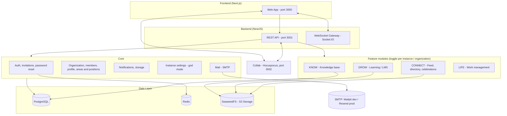

# Cluster

Employee Experience Platform (EXP) designed to centralize corporate life. Cluster unifies knowledge management, learning, internal communication and daily operations in a single web application that can be self-hosted per company.

**Public Site:** [clusterhq.app](https://clusterhq.app) · **Documentation (EN / ES):** [docs.clusterhq.app](https://docs.clusterhq.app) · **License:** [MIT](LICENSE) · **Contributing:** [CONTRIBUTING.md](CONTRIBUTING.md) · **Security:** [SECURITY.md](SECURITY.md)

## Table of Contents

- [Architecture Overview](#architecture-overview)
- [System Modules](#system-modules)
- [Instance and Organizations (god mode)](#instance-and-organizations-god-mode)
- [Access Control](#access-control)
- [Tech Stack](#tech-stack)
- [Prerequisites](#prerequisites)
- [Getting Started](#getting-started)
- [Commands Reference](#commands-reference)
- [Testing](#testing)
- [Project status](#project-status)
- [Database](#database)
- [File Storage](#file-storage)
- [Authentication](#authentication)
- [Project Structure](#project-structure)
- [Environment Variables](#environment-variables)
- [Deployment](#deployment)

## Architecture Overview

Cluster follows a modular monolith inside a monorepo. The backend exposes a REST API with WebSocket support; the frontend consumes it through a single web app. A small separate service, `collab`, handles realtime editing of KNOW pages.



## System Modules

Each feature module can be switched off per instance and per organization (see [god mode](#instance-and-organizations-god-mode)). A disabled module disappears from the navigation and its API returns `403`.

| Module | Status | What it does |
|---|---|---|
| **KNOW** | Implemented | Spaces and hierarchical pages with realtime collaborative editing, version history, documents and space files with in-app previews (images and PDFs), live space descriptions, tags, search over titles and page text, Markdown import/export, per-space access lists |
| **GROW** | Implemented | Full LMS: courses with sections and steps (text, video link, uploaded MP4/WebM video up to 1 GB with byte-range streaming, file and quiz lessons), mandatory assignments by person, area or position with due dates, My learning / Catalog / course player, quizzes with manual review queue, themed certificates (PDF + public verification page), compliance reports with CSV export and a dashboard |
| **CONNECT** | Implemented | Feed (posts, likes, comments, pinned announcements), directory with filters, interactive org chart, celebrations |
| **LIFE** | Stub | Scope to be validated (planned) |

> **Status (2026-11-19):** KNOW, GROW (including uploaded video lessons) and CONNECT are built, audited and covered by unit and e2e suites. Multi-tenant isolation is enforced by PostgreSQL Row-Level Security (RLS) across 28 tables, authentication is hardened (Postgres sessions, TOTP 2FA, lockout, uniform timing, security emails, nonce CSP), and instance/organization theming (with WCAG contrast verification and optional glass surfaces) is complete. See [Project status](#project-status).

Core (always on, never gated by a feature module): authentication, organization settings, members, **organization structure** (areas, positions, who holds them), user profile, notifications, storage, instance administration. Feature modules depend on core, never on each other.

## Instance and Organizations (god mode)

Administration has two levels:

| Level | Who | Manages |
|---|---|---|
| **Instance** | Superadmin (`User.isSuperAdmin`) — `/settings/instance` | Public sign-up on/off, default locale, modules available on the instance, instance brand theme and glass surfaces, whether organizations may set their own theme, creating and suspending organizations |
| **Organization (tenant)** | `ADMIN` of the organization — `/settings/organization`, `/settings/members`, `/settings/areas`, `/settings/positions`, `/settings/assignments`, `/settings/activity` | Organization name, logo, language, time zone, enabled modules (within those the instance offers), organization brand theme (when allowed), member profile locking, 2FA policy for admins, inviting or bulk-importing members (`.xlsx`), roles, deactivation, areas (org chart with drag-and-drop), positions, assignments and activity log |

- Roles inside an organization: `ADMIN`, `MANAGER`, `COLLABORATOR`. A user belongs to exactly one organization.
- The superadmin flag is independent from the role: a superadmin is also a member of their own organization.
- Effective modules for a user = instance `availableModules` ∩ organization `enabledModules`.

### Private (self-hosted) instance setup

1. Set `SUPERADMIN_EMAIL` / `SUPERADMIN_PASSWORD` (and optionally `SUPERADMIN_ORG_NAME`) before the first start. On boot, if no superadmin exists, the API creates one with its organization.
2. Sign in (the superadmin enrolls TOTP 2FA on first sign-in) and open **Settings → Instance**. A new installation starts with *Public sign-up* closed; visitors opening `/` on the web app go straight to `/login`.
3. Turn off the modules the company does not use (e.g. keep only KNOW and GROW).
4. In **Settings → Members**, invite people. Each one receives an email with a single-use link (valid 7 days) to set their password.
5. Define the structure in **Settings → Areas** (org chart tree with a manager per area), **Positions** (global or scoped to an area) and **Assignments** (who is in which area and position). LMS courses are assigned by area/position, and this keeps working with CONNECT switched off.
6. In **Settings → Members → Permissions**, give `GROW_COURSE_MANAGE` to the people who author and assign courses (and `KNOW_SPACE_CREATE` / `KNOW_SPACE_DELETE` as needed).

## Access Control

Three layers decide what a user can do; each is enforced on the API, and the web only mirrors it through `myRole` and `capabilities`.

1. **Instance and organization modules.** Effective modules = instance `availableModules` ∩ organization `enabledModules`. A disabled module answers `403`.
2. **Tenant role** (`ADMIN`, `MANAGER`, `COLLABORATOR`). `ADMIN` runs the organization and has unlimited access to every space. The `MANAGER` and `COLLABORATOR` roles grant nothing inside KNOW by themselves.
3. **Per-space access (KNOW).** Each space has an access list of entries `principal → role`, where the principal is a person, an area (its sub-areas included) or a position, and the role is `VIEWER`, `EDITOR` or `MANAGER`. A user's role in a space is the highest role among the entries that match them. A space is either open to the whole organization (everyone without an entry is `VIEWER`) or `restricted` (only listed principals). The creator of a space becomes its `MANAGER`.

| Role in the space | Can |
|---|---|
| `VIEWER` | Read published pages and documents |
| `EDITOR` | Also see drafts and archived pages, create, edit, delete pages, upload images and documents, save and restore versions (the version history is editor-only) |
| `MANAGER` | Also change the space settings and its access list (Share dialog) |

A space the user cannot read answers `404`, never `403`, so its existence does not leak; the same applies to lists, search and `@mentions`.

**Capabilities** are organization permissions granted per member by an `ADMIN` (Settings → Members → Permissions) and returned by `/auth/me`:

| Capability | Allows |
|---|---|
| `KNOW_SPACE_CREATE` | Create spaces |
| `KNOW_SPACE_DELETE` | Delete spaces (together with `MANAGER` in that space) |
| `GROW_COURSE_MANAGE` | Author, assign, review, archive any course of the organization, and see every report |

`ADMIN` has all of them implicitly. Each module adds its own capabilities by migration.

API: `GET/PUT /org/members/:id/capabilities` and `GET /org/capabilities` (admin), `GET|POST /know/spaces/:id/access`, `PATCH|DELETE /know/spaces/:id/access/:entryId` and `GET /know/spaces/:id/access/principals?q=` (space `MANAGER`). The decision logic lives in one place: `modules/know/space-access.ts` (pure rules, unit-tested) and `SpaceAccessService`; the principal context (user, area and ancestors, position) comes from core, in `modules/org/principal*.ts`.

**GROW (LMS)** reuses the same principal context with its own rules:

- **Course managers** (`ADMIN` or `GROW_COURSE_MANAGE`) can author, assign, review and archive every course. `CourseAccessService` (pure rules in `modules/grow/course-access.ts`) is the only place that decides `LEARN` / `MANAGE`.
- **Learners** see a published course if it is open to the organization or if an assignment reaches them (person, area with its sub-areas, or position). A course the user cannot see answers `404`.
- **Reports**: `ADMIN`, tenant `MANAGER` and `GROW_COURSE_MANAGE` holders see the whole organization; an area manager sees the areas they manage and every area below; anyone else gets `403` (`modules/grow/report-scope.ts`).

## Tech Stack

| Layer | Technology |
|---|---|
| **Runtime** | Node.js 24 (Docker images); >= 20.19 locally |
| **Backend Framework** | NestJS 11 (Express 5) |
| **Frontend Framework** | Next.js 16 (App Router) |
| **UI Components** | shadcn/ui + Radix + Tailwind CSS 4 |
| **Database** | PostgreSQL 16 (with Row-Level Security across 28 tenant tables) |
| **Cache & Rate Limiting** | Redis 7 (rate-limit counters) |
| **Object Storage** | SeaweedFS (S3-compatible) |
| **Email** | SMTP via nodemailer — Mailpit in dev, Resend in production |
| **Real-time** | Socket.IO (native NestJS Gateway); Hocuspocus + Yjs for collaborative editing (`apps/collab`) |
| **Editor & Theme** | Shared document schema in `packages/editor-schema`; WCAG contrast & theme derivation in `packages/theme` |
| **PDF** | pdfkit (certificates, rendered on demand with organization brand accent) |
| **ORM** | Prisma 7 (`@prisma/adapter-pg`) |
| **Auth** | JWT access tokens + Postgres-backed sessions (`httpOnly` cookie) + TOTP 2FA |
| **Validation** | class-validator + class-transformer |
| **Package Manager** | pnpm 9 |
| **Monorepo Tool** | Turborepo 2 |
| **Containerization** | Docker + Docker Compose |

## Prerequisites

- Node.js >= 20.19
- pnpm >= 9 (`corepack enable && corepack prepare pnpm@9.15.4 --activate`)
- Docker and Docker Compose

## Getting Started

### 1. Environment Setup

```bash
cp .env.example .env
```

Defaults work for local development except `COLLAB_INTERNAL_SECRET`, which must be set (e.g. `openssl rand -hex 32`). The API and collab both read it from `.env`; do not export a different value in your shell, it wins over `.env`.

### 2. Install Dependencies

```bash
pnpm install
```

### 3. Start Infrastructure

PostgreSQL, Redis, SeaweedFS (storage) and Mailpit (email inbox):

```bash
docker compose -f docker-compose.dev.yml up -d
```

SeaweedFS runs `docker/storage/start.sh` to configure its S3 credentials (no anonymous access); the API creates the bucket on startup.

### 4. Initialize Database

```bash
pnpm --filter @cluster/editor-schema build  # the seed imports the shared package (only needed on a fresh clone)
pnpm --filter @cluster/theme build          # same for the API and web (only needed on a fresh clone)
pnpm --filter @cluster/api db:roles         # creates cluster_app and cluster_system, the API's database roles, with the passwords in .env (BYPASSRLS needs a superuser)
pnpm --filter @cluster/api prisma:migrate   # apply migrations (as the owner, DATABASE_OWNER_URL)
pnpm --filter @cluster/api prisma:seed      # demo data (Prisma 7 does not seed automatically)
```

### 5. Start Development Servers

```bash
pnpm dev
```

| Application | URL |
|---|---|
| Web (Next.js) | http://localhost:3000 |
| API (NestJS) | http://localhost:3001 (health: `/api/v1/health`) |
| Collab (WebSocket) | ws://localhost:3002 |
| Mailpit inbox | http://localhost:8025 |
| SeaweedFS Master UI | http://localhost:9333 |
| SeaweedFS S3 Endpoint | http://localhost:9000 |

### Default Seed Data

| Entity | Value |
|---|---|
| Organization | `cluster` (Cluster) with logo, org chart, positions, ~37 employees, three KNOW spaces and two GROW courses with progress |
| Admin (superadmin) | `admin@cluster.example` / `Cluster-demo-2026`, then a 2FA code from the dev TOTP secret `CLUSTERDEMOADMINTOTPSECRETKEY234` (see `AGENTS.md`) |
| Employees | `<name>@cluster.example` / `Cluster-team-2026` |
| GROW | Demo courses "Workplace safety essentials" (mandatory for Engineering, overdue for Sales) and "Information security awareness" (everyone), with sample progress and certificates (also added to an existing database) |

## Commands Reference

All commands run from the repository root.

```bash
pnpm dev              # API + Web + collab in dev mode
pnpm api:dev          # API only (port 3001)
pnpm web:dev          # Web only (port 3000)
pnpm collab:dev       # Collab service only (port 3002)

pnpm build            # Build all apps
pnpm typecheck        # TypeScript --noEmit across apps
pnpm lint             # ESLint, plus the design-token guard (pnpm lint:tokens)
pnpm format
pnpm verify:tokens    # Contrast of every colour token pair, light and dark (also in pnpm test)

pnpm test             # Unit tests (Jest)
pnpm test:e2e         # API e2e tests (see Testing)
```

### Database (Prisma)

Prisma commands load the root `.env` via `dotenv-cli`:

```bash
pnpm --filter @cluster/api prisma:migrate       # Apply migrations (dev)
pnpm --filter @cluster/api prisma:seed          # Seed demo data
pnpm --filter @cluster/api prisma:generate      # Regenerate Prisma client
pnpm --filter @cluster/api prisma:studio        # Prisma Studio UI
pnpm --filter @cluster/api prisma:reset         # Drop DB and re-apply migrations
```

New migration after a schema change:

```bash
pnpm --filter @cluster/api exec dotenv -e ../../.env -- prisma migrate dev --name <migration_name>
```

## Testing

- **Unit** (`*.spec.ts`, Jest): `pnpm test`.
- **E2E** (`*.e2e-spec.ts`, Jest + Supertest): `pnpm test:e2e`. Needs the dev infrastructure running (Postgres, Redis, SeaweedFS, Mailpit).
  - They never touch your dev database: a Jest global setup (`apps/api/src/e2e-global-setup.ts`) drops and recreates `<POSTGRES_DB>_test`, applies migrations and seeds it on every run (so a new constraint migration can never trip on leftovers). Specs get an app and users from `createTestApp()` / `createActor()` in `apps/api/src/test-helpers.ts`; each organization-scoped feature needs a test that another organization cannot read or change its data.
  - Invitation and password-reset flows read the real emails from Mailpit's API.
- Current suite (2026-11-19): **2,143 unit tests** (across `web`, `editor-schema`, `theme`, `api`, `collab`, `site` and `docs`) and **810 e2e tests**. Organization isolation is proven by PostgreSQL RLS specs (`rls-isolation`, `rls-guards`, `rls-self-check`, `tenant-pool.integration`) and by feature e2e for CONNECT, organization structure, files, KNOW, documents and every GROW route; space access rules by `know-access`, `know-sharing` and `capabilities`; the LMS by `course-access`, `courses`, `course-content`, `course-video`, `assignments`, `learning`, `attempts`, `certificates` and `reports`. Realtime editing has integration e2e that boot the collab service.
- Conventions: test flows through the HTTP API, one data set per test via `createActor`, unit tests only for pure logic, and the failing test is written before the fix.
- **CI** (`.github/workflows/ci.yml`, on every pull request and on pushes to `main` and `dev`): `check` (typecheck, lint with the RLS and module-boundary guards, unit tests), `e2e` (the suite above against the dev compose services), `security` (gitleaks over the history; `pnpm audit` blocking at critical) and `images` (builds the `api`, `web` and `collab` images and scans them with Trivy). Dependabot proposes npm, GitHub Actions and Docker updates weekly.

## Project status

Verified on 2026-11-19: `pnpm typecheck`, `pnpm lint`, `pnpm test`, `pnpm test:e2e` and `pnpm build` all pass.

| Area | State |
|---|---|
| Tenant isolation (PostgreSQL RLS) | Enforced by Postgres (`tenant` policy on 28 tables): the API connects as `cluster_app` (no `BYPASSRLS`) and its system client as `cluster_system` (`BYPASSRLS`, DML only, owns nothing; the owner never enters the API container); proven by `rls-isolation`, `rls-guards`, `rls-self-check` and `tenant-pool.integration` e2e tests. Composite indexes verified against query plans as `cluster_app` |
| Auth, sessions, 2FA & instance (god mode) | Audited and hardened: sessions in Postgres behind an `httpOnly` cookie (`cluster_session`) with rotation and reuse detection, TOTP 2FA (required for the superadmin, optional per organization for ADMINs) with recovery codes, password policy and breach check, Entra-style lockout, uniform timings, auth events and security emails, own session management, CSP with per-request nonce |
| Organization structure, identity & theming | Audited; core API `/org/*` (areas with drag-and-drop, positions, assignments, activity log, member profile locking, `.xlsx` bulk member import); instance and organization brand themes + translucent glass surfaces verified for WCAG contrast by `@cluster/theme` (`pnpm verify:tokens`) |
| Bilingual (EN / ES) | Full English and Latin American Spanish (`tú`) localization across web, API (emails, certificate PDFs, CSV exports), public site and public documentation, guarded by catalog parity tests and ESLint `no-literal-string` |
| CONNECT | Audited and split by responsibility; isolation, feed, comments, directory (table, cards, interactive org chart) and celebrations covered by e2e and polished on the design system |
| KNOW | Audited: isolation, drafts, search, Markdown import/export and storage cleanup proven by e2e; per-space access list and member capabilities; realtime collaborative editing (`apps/collab`); page and space files with in-app image and PDF previews and live space description |
| GROW (LMS) | Full LMS delivered and audited: authoring, text/video-link/file/uploaded-video lessons (up to 1 GB with byte ranges, `course-video.e2e-spec.ts`), mandatory assignments by person/area/position, learner player, quizzes and manual review queue, themed PDF certificates with public verification, compliance reports, CSV export and dashboard |
| Public site & documentation | Hosted separately at [clusterhq.app](https://clusterhq.app) and [docs.clusterhq.app](https://docs.clusterhq.app) |
| LIFE | Stub (planned) |
| Storage | Private S3 bucket (SeaweedFS), content-based magic-byte file validation, byte-range streaming and per-resource access checks proven by e2e |
| Deployment | Docker images (`api`, `web`, `collab`), `docker-compose.yml` with optional Caddy TLS profile, backup/restore scripts (`scripts/backup/`, `restic`) and self-hosting guides ([docs.clusterhq.app](https://docs.clusterhq.app)) |

Known debt: three similar tree components in the web admin screens, CONNECT celebration settings live on the `Organization` table, realtime editing open items (listed in `AGENTS.md`). Module boundaries (core ← features, no feature → feature) are enforced by ESLint in both apps (`no-restricted-imports`).

## Database

- Schema: `apps/api/prisma/schema.prisma`
- Migrations: `apps/api/prisma/migrations/` (committed). Production applies them automatically on API container start (`prisma migrate deploy`).
- Constraints Prisma cannot express: hand-written SQL in a migration is only safe if Prisma still sees an index with the same name and columns. `NULLS NOT DISTINCT` on the area/position uniques survives (see `20261024220000_org_integrity`); partial and trigram indexes do not, `prisma migrate dev` drops them. Prefer a plain `@unique` on a nullable column (NULLs stay free).
- After `migrate dev` run `pnpm --filter @cluster/api prisma:generate` (Prisma 7 does not regenerate the client, and a stale one fails at runtime, not at typecheck).
- Seed: `apps/api/prisma/seed.ts` (demo data, development only — production uses the superadmin bootstrap instead).

## File Storage

Files live in a **private** S3 bucket (SeaweedFS). The browser never talks to storage:

- Every object key starts with `organizations/<orgId>/…`. Persist keys, not URLs.
- `GET /api/v1/files/<key>` serves a file only to signed-in members of that organization (404 otherwise), with `nosniff` and a sandbox CSP.
- ``, CSS backgrounds and download links can't send an `Authorization` header, so login/refresh also set an httpOnly `cluster_files` cookie (`SameSite=Lax`, path `/api/v1`). It is only accepted on routes marked `@AllowFileCookie()` (file reads and document downloads), and the user's status is re-checked on every request.
- `POST /api/v1/files/images` is the generic image upload (avatars, post images); module-specific uploads (KNOW inline images and documents, GROW lesson files) keep their own endpoints but are served by `/files`.

## Authentication

Short-lived JWT access tokens (15 min, sent as `Authorization: Bearer`, held in memory) and opaque refresh sessions stored in PostgreSQL (`auth_sessions`, sent in the `httpOnly` `cluster_session` cookie with `SameSite=Strict` and rotated with a 10 s grace window). Every request verifies the session ID (`sid`) and reads role, active status and enabled modules from the database, so admin changes and session revocations apply immediately.

### Account lifecycle

1. **Public sign-up** (only if the instance allows it): creates an organization with the caller as `ADMIN`.
2. **Invitation or bulk import**: an admin (or the superadmin, for a new organization) invites members or imports them via `.xlsx`; users receive a single-use link to `/set-password` (valid 7 days) or an access link when mail is disabled.
3. **Two-factor authentication (TOTP 2FA)**: mandatory for the superadmin and configurable as mandatory for organization `ADMIN`s; includes recovery codes, device migration and admin/operator MFA reset.
4. **Forgot password**: `/forgot-password` emails a single-use link (valid 1 hour). The endpoint never reveals whether an email exists.
5. Deactivating a user, changing their email, or suspending an organization revokes active sessions immediately.

### Security

- bcrypt (12 rounds) with SHA-256 prehash; password policy (8–72 chars, uppercase, number) and common-breach check
- Refresh-session rotation in Postgres with reuse detection (revokes the session family) and user-managed active sessions (`/api/v1/auth/sessions`)
- Entra-style progressive account lockout (`login_throttle`), uniform response timings on sign-in, and recorded security events (`auth_events`) with email alerts
- Password links: random 256-bit tokens, only their SHA-256 is stored, single use, a new link invalidates the previous one
- Per-request nonce Content-Security-Policy (CSP) served by `apps/web/proxy.ts`
- Rate limits: signed-in traffic counts per person, never per IP address alone, so an office behind one public IP is not locked out (`common/throttle-tracker.ts`)

### Endpoints

| Method | Path | Auth | Description |
|---|---|---|---|
| POST | `/api/v1/auth/register` | Public | Create organization + admin (when sign-up is open) |
| POST | `/api/v1/auth/login` | Public | Sign in |
| POST | `/api/v1/auth/refresh` | Public | Rotate refresh token |
| POST | `/api/v1/auth/logout` | JWT | Revoke refresh token |
| POST | `/api/v1/auth/set-password` | Public | Accept invitation / reset link |
| POST | `/api/v1/auth/forgot-password` | Public | Email a reset link |
| GET | `/api/v1/auth/me` | JWT | Current user, organization and modules |
| PATCH | `/api/v1/auth/me` | JWT | Update name, avatar, timezone |
| PATCH | `/api/v1/auth/me/password` | JWT | Change password |
| GET/PATCH | `/api/v1/profile/me` | JWT | Bio, phone; area/position (read-only) |
| GET/PATCH | `/api/v1/org` | ADMIN | Organization settings and modules |
| GET/POST | `/api/v1/org/members` | ADMIN | List / invite members |
| PATCH | `/api/v1/org/members/:id` | ADMIN | Change role or active status |
| POST | `/api/v1/org/members/:id/resend-invite` | ADMIN | Resend invitation |
| GET | `/api/v1/org/areas` | JWT | Org chart (flat list; every member can read it) |
| GET | `/api/v1/org/areas/full` | ADMIN | Areas with their positions and member counts |
| POST/PATCH/DELETE | `/api/v1/org/areas[/:id]` · `PATCH /:id/move` | ADMIN | Create, rename, re-parent, archive (`DELETE ?reassignTo=<areaId>` moves its members) |
| GET | `/api/v1/org/positions` | JWT | Positions (`?includeInactive=true` for admins) |
| GET | `/api/v1/org/positions/for-area/:areaId` | ADMIN | Global positions plus those scoped to the area |
| POST/PATCH/DELETE | `/api/v1/org/positions[/:id]` · `POST /:id/archive` | ADMIN | Manage positions |
| PATCH | `/api/v1/org/members/:userId/assignment` | ADMIN | Set a member's area and/or position |
| GET | `/api/v1/instance/public` | Public | Instance name, sign-up and landing flags |
| GET/PATCH | `/api/v1/instance/settings` | Superadmin | Instance settings |
| GET/POST | `/api/v1/instance/organizations` | Superadmin | List / create organizations |
| PATCH | `/api/v1/instance/organizations/:id` | Superadmin | Rename / suspend |
| GET | `/api/v1/files/<key>` | JWT or file cookie | Serve a stored file (own organization only) |
| POST | `/api/v1/files/images` | JWT | Upload an image, returns `{ key, url }` |
| GET | `/api/v1/connect/feed` | JWT + CONNECT | Feed (`?sort=top` or `recent`, cursor pagination); pinned announcements first |
| POST/PATCH/DELETE | `/api/v1/connect/posts[/:id]` | JWT + CONNECT | Author or admin; announcements and pinning need `ADMIN`/`MANAGER`; images must be own uploads |
| POST | `/api/v1/connect/posts/:id/like` | JWT + CONNECT | Toggle like |
| GET/POST | `/api/v1/connect/posts/:id/comments` · `DELETE /connect/comments/:id` | JWT + CONNECT | Comments (delete: author or `ADMIN`) |
| GET | `/api/v1/connect/directory[/:userId]` · `feed/suggestions` | JWT + CONNECT | Member directory with filters, profile with area path |
| GET/POST | `/api/v1/connect/celebrations/today` · `reactions` | JWT + CONNECT | Today's birthdays and anniversaries (organization time zone and settings) |
| GET/PATCH | `/api/v1/connect/celebrations/settings` | JWT / ADMIN to change | Enable celebrations, birthdays, anniversaries |
| GET | `/api/v1/grow/learning` · `catalog` · `courses/:id` | JWT + GROW | My learning, catalog, course overview (`?preview=1` for managers) |
| POST | `/api/v1/grow/courses/:id/enroll` · `GET|POST courses/:id/steps/:stepId[/complete]` | JWT + GROW | Enrol, open a step, mark it complete |
| GET/POST/PATCH/DELETE | `/api/v1/grow/manage/courses` · `courses[/:id]` · `courses/:id/edit` · `/publish` · `/archive` · `/restore` | Course manager | Author and manage the course lifecycle |
| POST/PATCH/DELETE | `/api/v1/grow/courses/:id/sections` · `sections/:id[/move]` · `sections/:id/steps` · `steps/:id[/move]` · `courses/:id/files` | Course manager | Outline, step content, lesson files |
| GET/POST/PATCH/DELETE | `/api/v1/grow/courses/:id/assignments` · `assignments/:id` | Course manager | Assign by person, area or position, with due date |
| POST/GET | `/api/v1/grow/courses/:id/steps/:stepId/attempts` · `attempts/:id[/submit]` | JWT + GROW | Start/resume and submit a quiz attempt |
| GET/PATCH | `/api/v1/grow/courses/:id/reviews` · `attempts/:id/grade` | Course manager | Review queue for answers graded by hand |
| GET | `/api/v1/grow/certificates` · `certificates/:id/pdf` | JWT + GROW (owner) | My certificates and their PDF |
| GET | `/api/v1/grow/verify/:code` | Public (throttled) | Verify a certificate code |
| GET | `/api/v1/grow/reports/compliance[/export\|/dashboard]` | Report scope | Compliance report with filters and pagination, CSV export, dashboard figures over the same rows |
| GET | `/api/v1/health` | Public | Liveness + database check |

Access rules are declared with decorators (`@Roles`, `@SuperAdminOnly`, `@RequireModule`) and enforced by a global `AccessGuard`.

## Project Structure

```text
cluster/
├── apps/
│   ├── api/                          # NestJS backend
│   │   ├── prisma/                   # schema.prisma, migrations/, seed.ts
│   │   └── src/
│   │       ├── common/               # decorators, guards (JWT, Access), instance settings
│   │       ├── prisma/               # PrismaService
│   │       ├── modules/
│   │       │   ├── auth/             # login, tokens, invitations, password reset
│   │       │   ├── instance/         # god mode: instance settings + organizations
│   │       │   ├── org/              # organization, members, profile, areas + positions (core)
│   │       │   ├── mail/             # SMTP mail service
│   │       │   ├── storage/          # private S3 storage + /files
│   │       │   ├── notification/
│   │       │   ├── know/ documents/  # KNOW: spaces, pages, versions, media, tags, search, space access
│   │       │   ├── grow/             # GROW LMS: courses, content, assignments, learning, quizzes, certificates, reports
│   │       │   ├── connect/          # CONNECT: posts, comments, directory, celebrations
│   │       │   └── life/             # LIFE
│   │       ├── health.controller.ts
│   │       └── main.ts
│   ├── web/                          # Next.js frontend
│   │   ├── app/
│   │   │   ├── (app)/                # authenticated area (know, grow, connect, settings incl. instance)
│   │   │   ├── login/ register/ forgot-password/ set-password/
│   │   │   ├── verify/               # public certificate verification page
│   │   │   └── page.tsx              # redirects to /login
│   │   ├── components/               # ui/ (shadcn), shared/, settings/ (core admin), instance/, know/, grow/, connect/
│   │   ├── hooks/
│   │   └── lib/                      # api.ts, org-api.ts (areas/positions/profile), admin-api.ts, connect-api.ts, auth context, modules, navigation
│   └── collab/                       # realtime editing service (Hocuspocus); the API talks to it over HTTP
├── packages/
│   ├── editor-schema/                # shared document schema (API validates, collab converts, web renders)
│   └── theme/                        # theme contract and WCAG contrast verifier shared by API and web
├── docker/                           # Dockerfile.api, Dockerfile.web, Dockerfile.collab, Caddyfile, storage/start.sh
├── docker-compose.dev.yml            # Dev infrastructure (Postgres, Redis, SeaweedFS, Mailpit)
├── docker-compose.yml                # Production stack
└── turbo.json
```

## Environment Variables

A single `.env` at the repository root (see `.env.example`).

| Variable | Description | Default |
|---|---|---|
| `API_PORT` / `WEB_PORT` | Ports | `3001` / `3000` |
| `DATABASE_URL` | The API's connection, as the `cluster_app` role (row-level security applies; the API refuses to start as a superuser, a `BYPASSRLS` role or a table owner) | built from `CLUSTER_APP_PASSWORD` and `POSTGRES_*` |
| `CLUSTER_APP_PASSWORD` | Password of `cluster_app`; `db:roles` (and the API image on start) sets it from `DATABASE_URL` | `cluster_app` |
| `DATABASE_SYSTEM_URL` | The system client's connection (auth, instance, cross-organization work, operator commands), as the `cluster_system` role: bypasses RLS, DML only, owns nothing; the API refuses to start otherwise — **required** | built from `CLUSTER_SYSTEM_PASSWORD` and `POSTGRES_*` |
| `CLUSTER_SYSTEM_PASSWORD` | Password of `cluster_system`; `db:roles` (the compose `migrate` service) sets it from `DATABASE_SYSTEM_URL` | `cluster_system` |
| `DATABASE_OWNER_URL` | The owner of the tables: migrations, `db:roles`, seed, backups. Not given to the API container (only to the compose `migrate` service) — **required** for those | built from `POSTGRES_*` |
| `DB_POOL_MAX` / `DB_CONNECTION_TIMEOUT_MS` / `DB_STATEMENT_TIMEOUT_MS` / `DB_IDLE_IN_TX_TIMEOUT_MS` | The API's connection pool: size, wait for a free connection, longest statement, longest idle transaction | `10` / `5000` / `30000` / `60000` |
| `REDIS_HOST` / `REDIS_PORT` / `REDIS_PASSWORD` | Redis | `localhost` / `6379` |
| `STORAGE_HOST` / `STORAGE_PORT` | S3 endpoint used by the API (never by the browser) | `localhost` / `9000` |
| `STORAGE_ACCESS_KEY` / `STORAGE_SECRET_KEY` / `STORAGE_BUCKET` | Storage credentials (the storage container takes the same pair) and bucket | `cluster-storage` / `cluster-storage-secret` / `cluster` |
| `JWT_SECRET` | JWT signing secret — in production the API refuses to start unless it is random and at least 32 characters (same for non-default `STORAGE_ACCESS_KEY` / `STORAGE_SECRET_KEY`) | `change-me-in-production` |
| `TRUST_PROXY` | Number of reverse proxies in front of the API (e.g. `1`), so per-IP rate limits see the client's address | empty |
| `WS_CORS_ORIGIN` | Allowed browser origin (CORS + WebSocket) | `http://localhost:3000` |
| `WEB_URL` | Public web URL, used in email links | `http://localhost:3000` |
| `NEXT_PUBLIC_API_URL` / `NEXT_PUBLIC_WS_URL` | Public API URLs for the browser (inlined at web build time). The API also uses `NEXT_PUBLIC_API_URL` to build file URLs | `http://localhost:3001/...` |
| `NEXT_PUBLIC_COLLAB_URL` | Public WebSocket URL of the collab service (inlined at web build time; `wss://…/collab` behind a proxy) | `ws://localhost:3002` |
| `COLLAB_INTERNAL_SECRET` | Secret shared by the API and collab for their internal calls — **required**, e.g. `openssl rand -hex 32`. A value exported in the shell wins over `.env` | empty |
| `COLLAB_PORT` / `COLLAB_ALLOWED_ORIGINS` / `COLLAB_MAX_DOC_BYTES` | Collab port, browser origins allowed to open WebSockets (comma-separated), largest document | `3002` / `http://localhost:3000` / 10 MB |
| `COLLAB_URL` / `COLLAB_API_URL` | Where the API reaches collab, and where collab reaches the API (internal; compose sets both to the service names) | `http://localhost:3002` / `http://localhost:3001/api/v1` |
| `SMTP_HOST` / `SMTP_PORT` / `SMTP_SECURE` / `SMTP_USER` / `SMTP_PASS` | SMTP server; an empty `SMTP_HOST` turns mail off (admins hand over access links or initial passwords) | `.env.example`: Mailpit `localhost:1025`; compose: empty |
| `MAIL_INVITES_PER_MINUTE` | Pace of the invitations queued for an area (`0` pauses them) | `60` |
| `MAIL_FROM` | Sender | `Cluster <no-reply@cluster.local>` |
| `SUPERADMIN_EMAIL` / `SUPERADMIN_PASSWORD` / `SUPERADMIN_ORG_NAME` | First-boot superadmin (skipped if one exists) | empty |

Resend in production: `SMTP_HOST=smtp.resend.com`, `SMTP_PORT=465`, `SMTP_SECURE=true`, `SMTP_USER=resend`, `SMTP_PASS=<API key>`, and a `MAIL_FROM` on a domain verified in Resend.

## Deployment

Full self-hosting guides (requirements, Docker Compose setup, reverse proxy, updates, backups, monitoring, and troubleshooting) live at [docs.clusterhq.app](https://docs.clusterhq.app).

Backups: `scripts/backup/` (`pg_dump` as the owner plus a bucket mirror, both to `restic` off the host). Always run a restore drill before going live.

> **Database roles (RLS).** The API connects as `cluster_app` (`DATABASE_URL`, password `CLUSTER_APP_PASSWORD` in `.env`) and its system client as `cluster_system` (`DATABASE_SYSTEM_URL`, `CLUSTER_SYSTEM_PASSWORD`: bypasses RLS, DML only, no DDL). Migrations, the seed and backups use the owner (`DATABASE_OWNER_URL`), which only the one-shot `migrate` service (`db:roles`, then `prisma migrate deploy`) receives; the API container never has it. Granting `BYPASSRLS` needs a superuser (or the managed provider's equivalent) when `db:roles` runs. Back up as the owner with `pg_dump`, never with `--enable-row-security`.

```bash
# 1. Configure .env: JWT_SECRET, COLLAB_INTERNAL_SECRET, WEB_URL, WS_CORS_ORIGIN,
#    COLLAB_ALLOWED_ORIGINS, NEXT_PUBLIC_API_URL, NEXT_PUBLIC_WS_URL,
#    NEXT_PUBLIC_COLLAB_URL (public URLs), SMTP_*, SUPERADMIN_*, STORAGE_* keys, TRUST_PROXY
docker compose build
docker compose up -d
```

- The `migrate` service creates the roles and applies pending migrations, then exits; the API starts after it succeeds and bootstraps the superadmin if none exists.
- `NEXT_PUBLIC_*` are baked into the web image: rebuild it when they change.
- The web (3000), API (3001) and collab (3002) ports are published on `127.0.0.1` only; Postgres, Redis and storage stay inside the compose network. Public traffic goes through a proxy with TLS: see "TLS and the proxy".
- Every service rotates its Docker logs (10 MB x 5 files). The API's `GET /api/v1/health` answers `{ "status", "checks": { "database", "redis", "storage" } }`: 503 when Postgres is down, 200 otherwise, with `status: "degraded"` when Redis or storage do not answer (Redis only backs the rate limit, which fails open). Monitoring and alerts are documented in [docs.clusterhq.app](https://docs.clusterhq.app).
- `collab` is the realtime editing service (Node 22, Hocuspocus). It talks to the API over the compose network and needs `COLLAB_INTERNAL_SECRET`: compose refuses to start without it. On stop it saves the open documents first (`stop_grace_period: 30s`). If it is down, pages stay readable and editable through REST actions, but live editing shows "Offline"; the API never fails a request because collab did not answer.
- Web and API must be on the same site (same host, or subdomains of one domain such as `app.example.com` / `api.example.com`) so the browser sends the file cookie with `` requests. Use HTTPS in production (the cookie is `Secure` when `WEB_URL` is https).
- Images: `docker/Dockerfile.api` and `docker/Dockerfile.web` (Next.js standalone output), Node 24; `docker/Dockerfile.collab`, Node 22; all with non-root users.

### TLS and the proxy

Only 80 and 443 are public. Two ways to get there:

**Bundled Caddy** (`docker/Caddyfile`, compose profile `proxy`, off by default). One site serves everything, so the session cookie (`SameSite=Strict`) works. Point a DNS name at the server, then in `.env`:

```sh
CLUSTER_DOMAIN=app.example.com
WEB_URL=https://app.example.com
WS_CORS_ORIGIN=https://app.example.com
COLLAB_ALLOWED_ORIGINS=https://app.example.com
NEXT_PUBLIC_API_URL=https://app.example.com/api/v1
NEXT_PUBLIC_WS_URL=https://app.example.com
NEXT_PUBLIC_COLLAB_URL=wss://app.example.com/collab
TRUST_PROXY=1
```

```sh
docker compose build                       # NEXT_PUBLIC_* are baked into the web image
docker compose --profile proxy up -d
```

Caddy gets and renews the certificate itself (ports 80 and 443 must be reachable from the internet). Always pass `--profile proxy` on later `up`, `ps` and `logs` too, or Compose ignores the service.

**The client's own proxy.** Leave the profile off and make it do what the Caddyfile does:

- [ ] TLS on 443 (and 80 redirecting to it); `TRUST_PROXY=1` (one hop) so rate limits see the real address; it must set `X-Forwarded-For` and `X-Forwarded-Proto`.
- [ ] `/api/v1/internal/*`, `/collab/control/*`, `/collab/health` and `/control/*` answer 404; never proxied.
- [ ] `/api/*` and `/socket.io/*` (WebSocket upgrade) go to `127.0.0.1:3001`; `/collab/*` (WebSocket, prefix stripped) to `127.0.0.1:3002`; everything else to `127.0.0.1:3000`.
- [ ] Only `PUT /api/v1/grow/steps/<id>/video`: body up to 1100 MB, request buffering off, read timeout 1 h (see "Lesson videos"). Everything else keeps ordinary limits (60 MB body is enough for the largest upload) and a read timeout of at least 2 min, like the Caddyfile: a credentials export of 500 initial passwords takes about 40 s, and the credentials it replaced are gone even if the proxy drops the file.
- [ ] One registrable domain for web and API, and the URL variables above on `https://`.
- [ ] Do not add a second CSP: the apps send theirs.

**Firewall.** Allow only SSH, 80 and 443. Docker publishes ports around `ufw`, which is why the compose file binds the three app ports to `127.0.0.1`; the rules are still the second wall:

```sh
sudo ufw default deny incoming && sudo ufw allow OpenSSH && sudo ufw allow 80/tcp && sudo ufw allow 443/tcp && sudo ufw allow 443/udp && sudo ufw enable
```

### Reverse proxy for collab

The browser opens a WebSocket to collab, and the API and collab call each other on internal routes that must never be reachable from outside. Behind HTTPS, publish collab under `/collab` (set `NEXT_PUBLIC_COLLAB_URL=wss://app.example.com/collab` and add that origin to `COLLAB_ALLOWED_ORIGINS`), and block `/api/v1/internal` and `/control`. For nginx:

```nginx
# Internal routes: only the compose network may call them.
location /api/v1/internal/ { return 404; }
location /control/          { return 404; }

location /collab/ {
  proxy_pass http://collab:3002/;          # the trailing slash strips /collab
  proxy_http_version 1.1;
  proxy_set_header Upgrade $http_upgrade;
  proxy_set_header Connection "upgrade";
  proxy_set_header Host $host;
  proxy_read_timeout 120s;                 # idle sockets are kept alive by pings; do not cut them earlier
}
```

### Lesson videos

GROW lessons can hold an uploaded video (MP4 or WebM, up to 1 GB), sent as the body of `PUT /api/v1/grow/steps/:id/video` and played from `/api/v1/files` with byte ranges. The API writes the upload to a temporary file before storing it (folder `UPLOAD_TMP_DIR`, else the system temp folder, which is memory on hosts where `/tmp` is tmpfs; in Docker mount a volume there), so that folder needs room for the uploads in flight. At most 3 uploads run at once per API instance, and one that would leave under 512 MB free is refused (503 `UPLOAD_BUSY`, 507 `UPLOAD_NO_SPACE`, both translated in the web). The API's memory limit is `API_MEMORY_LIMIT` (1 GB by default). The bundled Caddy already does this for the video route only; for nginx, use a separate location for it:

```nginx
# Only this route takes the big, slow, unbuffered upload.
location ~ ^/api/v1/grow/steps/[^/]+/video$ {
  proxy_pass http://api:3001;
  client_max_body_size 1100m;              # a 1 GB video plus headers
  proxy_request_buffering off;             # stream the upload to the API instead of to nginx's disk
  proxy_read_timeout 3600s;                # the API waits up to 1 h for a slow upload
}
location /api/ {
  proxy_pass http://api:3001;
  client_max_body_size 60m;
}
```

#### Cleaning up orphan lesson files

A video or file can stay in the bucket without a lesson: a crash between storing it and saving the lesson, a file taken out of a lesson, the files of a deleted step. Once a week, from the server, inside the API container (the compiled scripts are in the image; no repository checkout or pnpm needed), list and then delete them:

```sh
docker compose exec api node dist/scripts/sweep-lesson-files.js           # dry run: lists what nothing references
docker compose exec api node dist/scripts/sweep-lesson-files.js --apply   # deletes it
```

Cron, Sundays at 03:00 (adjust the path): `0 3 * * 0  cd /srv/cluster && docker compose exec -T api node dist/scripts/sweep-lesson-files.js --apply >> /var/log/cluster-sweep.log 2>&1`. It skips anything younger than an hour. Never run it against a database restored from an older backup than the bucket: it would delete files that the newer database still uses.

#### Cleaning up auth tables

Sessions past their absolute expiry, used or expired 2FA challenges and password links, `login_throttle` rows that no longer lock or count, and `auth_events` older than `AUTH_EVENTS_RETENTION_DAYS` (default 365) are removed by one command. Without it these tables only grow (`login_throttle` and `auth_events` with failed sign-ins on random emails).

```sh
docker compose exec api node dist/scripts/sweep-auth.js           # dry run: counts per table
docker compose exec api node dist/scripts/sweep-auth.js --apply   # deletes them
```

Cron, daily at 03:30: `30 3 * * *  cd /srv/cluster && docker compose exec -T api node dist/scripts/sweep-auth.js --apply >> /var/log/cluster-sweep.log 2>&1`. It never touches a live session, a pending challenge or link, or a throttle row that still counts.
